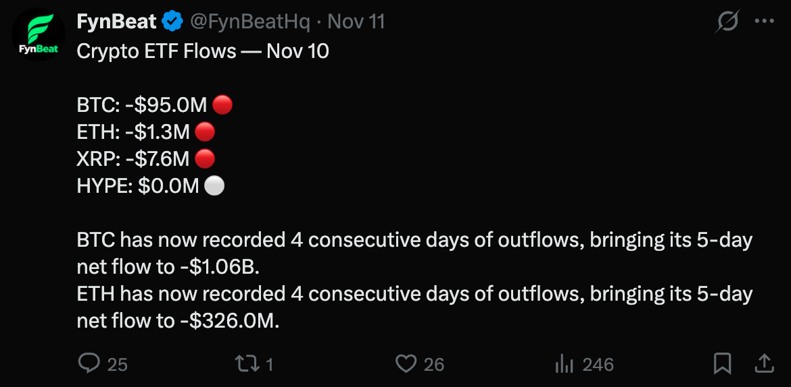
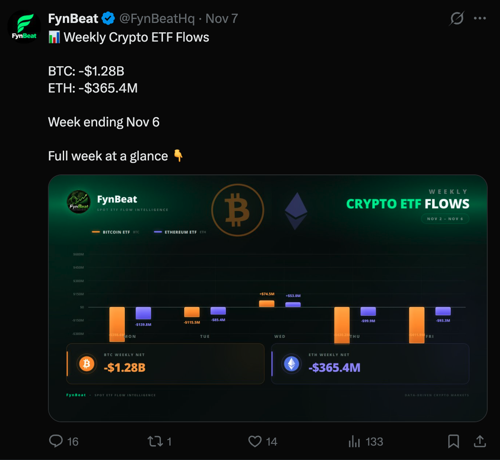
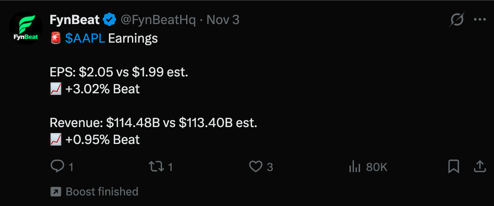
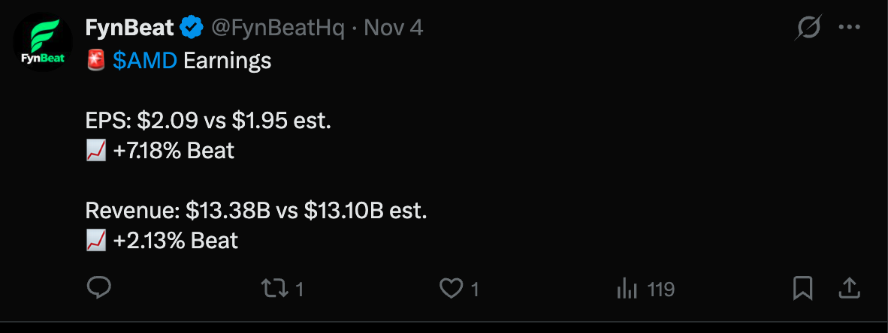
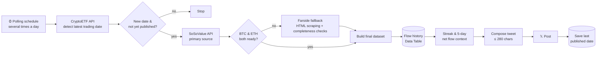
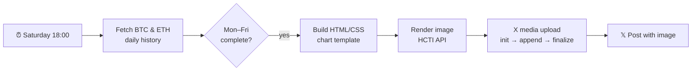
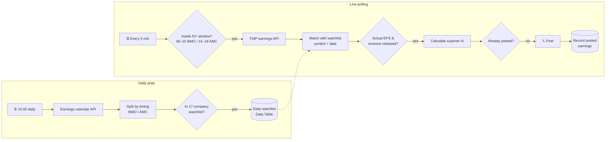

<p align="center">
  
</p>

<h1 align="center">FynBeat – Automated Market Intelligence Bot</h1>

<p align="center">
  Production n8n workflows that turn raw market data into verified, ready-to-read posts on X (Twitter) — every trading day, with no manual work.
</p>

<p align="center">
  
  
  
  
</p>

<p align="center">
  🔴 <b>Live on X:</b> <a href="https://x.com/FynBeatHq">@FynBeatHq</a>
</p>

---

## Overview

FynBeat is a set of always-on n8n workflows that monitor financial data sources and publish posts on X automatically. It is made of two independent pipelines:

| Pipeline | What it does | Cadence |
|---|---|---|
| **[Crypto ETF Flow Tracker](docs/etf-flow-tracker.md)** | Publishes daily US spot Bitcoin & Ethereum ETF net flows, with streak and 5-day context, plus a branded weekly chart. | Daily + weekly (Saturday) |
| **[Earnings Tracker](docs/earnings-tracker.md)** | Watches 17 large-cap US companies and posts EPS & revenue vs. estimates the moment results are released. | Every 5 min during US pre-market & after-hours windows on earnings days |

Both pipelines follow the same design principle: **fail closed**. If the data is missing, incomplete, inconsistent or already published, nothing gets posted.

---

## Live posts

Real, unedited posts published automatically by these workflows on [@FynBeatHq](https://x.com/FynBeatHq).

**Daily ETF flows with streak and 5-day context**



**Weekly ETF report: chart rendered from an HTML/CSS template**



**Earnings results, posted minutes after release**





---

## Architecture

### 1. Crypto ETF Flow Tracker





### 2. Earnings Tracker



---

## Engineering highlights

- **Multi-source data with fallback.** ETF flows come from SoSoValue; if an asset is not ready, the workflow falls back to parsing Farside's HTML table and checks that every fund column is filled in, so a partial total is never accepted.
- **Duplicate protection.** n8n Data Tables store the last published trading date, the last published week and every earnings post (symbol + date), so the same data is never posted twice.
- **Fail-closed validation at every stage.** Dates, symbols, numeric types and asset completeness are checked before anything is built. A real `0` flow is treated as valid, and missing data is never treated as `0`.
- **Time-zone aware scheduling.** Earnings polling runs only inside US pre-market and after-hours windows, using `America/New_York` so daylight saving time is handled automatically.
- **Stateful context.** A rolling flow history powers phrases like *"3 consecutive days of inflows"* and the 5-day net flow, with a compact fallback format when the tweet would exceed 280 characters.
- **Programmatic graphics.** The weekly report is a dynamic HTML/CSS template with an auto-scaling Y-axis, rendered to an image and posted through the X API v2 chunked media upload.
- **Publish verification.** The earnings post is only recorded as done after the X API returns a valid tweet ID.

---

## Tech stack

| Area | Tools |
|---|---|
| Orchestration | n8n (Schedule Trigger, Code, IF, Merge, HTTP Request, Data Tables, X node) |
| Logic | JavaScript (Code nodes), Luxon date handling |
| Data sources | CryptoETF API, SoSoValue OpenAPI, Farside (fallback), Financial Modeling Prep, EarningsAPI |
| Rendering | HTML/CSS → HCTI (htmlcsstoimage) API |
| Publishing | X API v2 (OAuth 2.0 for posts, OAuth 1.0a for media upload) |
| State | n8n Data Tables |

---

## Repository structure

```text
.
├── workflows/
│   ├── etf-flow-tracker.json     # daily + weekly crypto ETF pipeline (59 nodes)
│   └── earnings-tracker.json     # 17-company earnings pipeline (23 nodes)
├── docs/
│   ├── etf-flow-tracker.md       # node-by-node walkthrough
│   ├── earnings-tracker.md       # node-by-node walkthrough
│   └── setup.md                  # how to import and run
└── assets/                       # logo and sample report image
```

---

## Getting started

1. Import a file from `workflows/` into n8n (**Workflows → Import from File**).
2. Create the required credentials and Data Tables.
3. Replace the `YOUR_...` placeholders with your own API keys.

The full guide is in **[docs/setup.md](docs/setup.md)**.

> All API keys, credential IDs and instance identifiers have been removed from the exported workflows.

---

## Disclaimer

This project is for informational purposes only and is not investment advice. Data accuracy depends on third-party providers.
